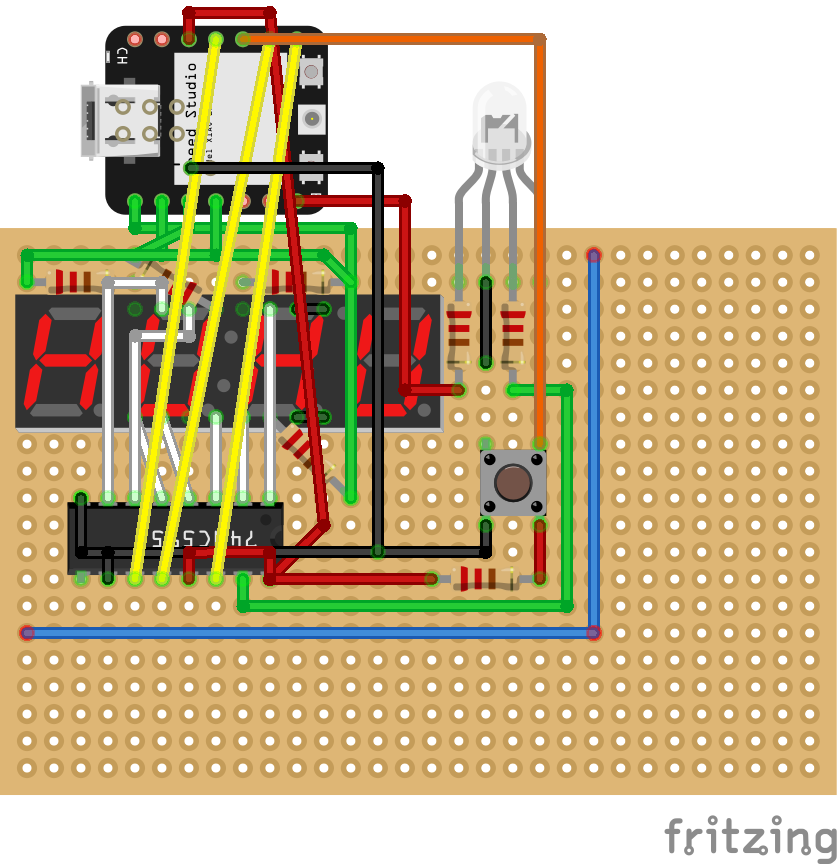
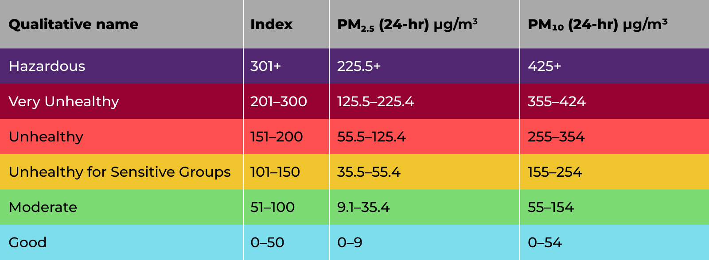
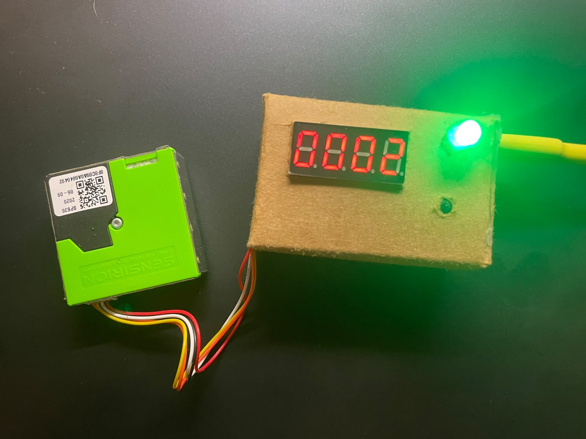
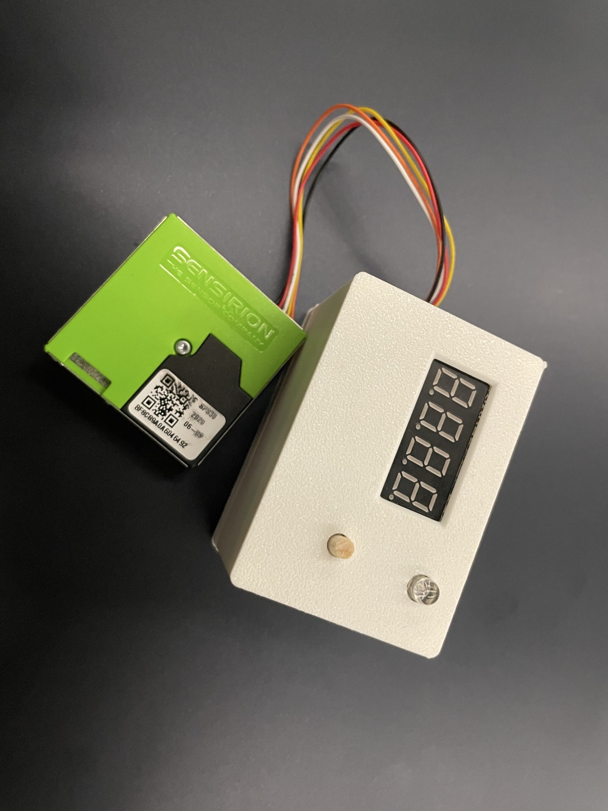

# Air Quality Monitor
A repository about building an air quality monitor with a SPS30 particulate matter sensor and 4-digit 7-segment display.

# Components Used
- Seeed Studio XIAO ESP32C3
- SPS30 PM2.5 Sensor
- 4-digit 7-segment Displa
- 74HC595 Shift Register
- - RGB LED
- Push Button
- - 4 x 330 ohms Resistors for 4-digit 7-segment Display
- 2 x 220 ohms Resistors for RGB LED
- 10k Resistor for Pull-Up Resistor in Button
- Perfboard to Solder Onto
- 8 x 5 mm by 2 mm Neodymium Disc Magnets
- < 4 mm diameter wood rod (if you are 3D printing the case)

# Circuit Diagram
Note that SPS30 is not on the schematic, but you should wire them appropriately to pins GND, 5V, SDA and SCL.

# Functions
It measures concentration and number of particulate matter of size PM1.0, PM2.5, PM4.0, and PM10.0 and typical size of the particles. (for reference, PM2.5 is equal to 2.5 micrometers)
Displays the readings on to the 4-digit 7-segment display and lights up appropriate LED color based on an appropriate range (line 284 & 293 in .ino file) referenced to the chart below.

Credit: ATMO https://atmotube.com/blog/particulate-matter-pm-levels-and-aqi

# Housing
## Cardboard
I cut out a case with cardboard to cover the wires and glued four magnets on each of the case and SPS30 to make the sensor detachable from the case.

## Plastic
If you have a 3D printer, you can 3D print the case for the air quality monitor. The lid snaps into the case body and there are four holes to glue magnets into. Note that because the case thickness is thin, the top part of the case body where there is a chamfer might not 3D print properly. Once the case has been printed, hot glue the four corners of perfboard onto the mounts attach a wood rod on top of the push button, so you can press it from outside the case.

